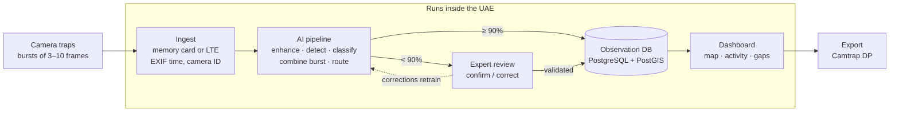
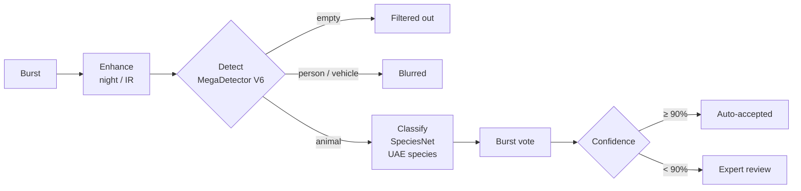
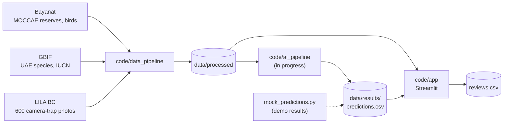

# KAMouflage Vision

AI triage for camera-trap photos. It filters out empty frames, identifies UAE wildlife (including camouflaged and
night-time animals), and sends only uncertain shots to an expert. The validated observations feed a dashboard of
where each species is and when it's active.

Built for the MOCCAE camera-trap challenge at UAE Hackathon 2026 (Track 2, Abu Dhabi).

## Run it

Requires Python 3.11+.

```bash
python -m venv .venv
.venv\Scripts\activate            # macOS/Linux: source .venv/bin/activate
pip install -r requirements.txt
streamlit run code/app/app.py     # http://localhost:8501
```

The demo data is already in the repo. Optional:

```bash
python code/app/mock_predictions.py        # regenerate demo AI results
python code/data_pipeline/fetch_all.py     # re-download all data (~300 MB)
python code/diagrams/make_diagrams.py      # PNG diagrams for slides (docs/diagrams/)
```

To reset the review queue, delete `data/results/reviews.csv`.

## System architecture

Target deployment for a MOCCAE pilot. Everything inside the box runs on a MOCCAE server or UAE sovereign cloud.



### What happens to one burst



### Models and licensing

| Step | Model | License |
|---|---|---|
| Detection | MegaDetector V6 (`MDV6-mit-yolov9-c` or `MDV6-apa-rtdetr-e`) | MIT / Apache-2.0 |
| Species | SpeciesNet classifier, fed our own detections, geofenced to the UAE | Apache-2.0 |
| Rare species fallback | BioCLIP 2 (zero-shot) | MIT |

MegaDetector v5 and the V6 `yolov10` variants are AGPL-3.0 and are not used. All models run locally, so no
images leave the deployment.

## Prototype (this repo)



The app only reads `predictions.csv`, so the AI pipeline and the app can be developed separately. The format is
in [code/CONTRACT.md](code/CONTRACT.md).

| App page | Purpose |
|---|---|
| Import Photos | Run a camera's photos through the pipeline, or upload your own |
| Gallery | Every photo with its result; toggle enhancement for night shots |
| Review Queue | Confirm or correct uncertain bursts |
| Insights Dashboard | Reserve map, coverage gaps, activity by hour, trends, CSV export |
| About & Data | Data sources, estimates, demo settings |

## Repository layout

```
code/
  app/              Streamlit app (app.py, views/, lib.py)
  data_pipeline/    fetch and clean Bayanat, GBIF, LILA data
  diagrams/         PNG/SVG diagrams for slides
  CONTRACT.md       AI pipeline → app data format
data/
  raw/              downloaded sources
  processed/        images.csv, cameras.csv, species_reference.csv, protected_areas.csv
  results/          predictions.csv (+ local reviews.csv)
docs/
  diagrams/         exported diagrams
  CHECKLIST.md      open questions and risks
PROJECT_NOTES.md    background, decisions, sources
```

## Data

Real camera-trap photos from arid southern Africa (LILA BC, CDLA-Permissive) stand in for UAE species, since UAE
archives are not public. Reserves and the local bird list come from MOCCAE via Bayanat, and species with IUCN
status from GBIF. Camera positions are simulated. Details: [data/README.md](data/README.md).
