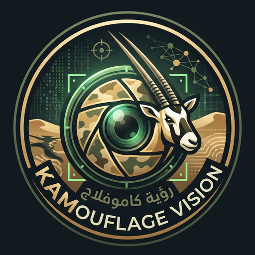
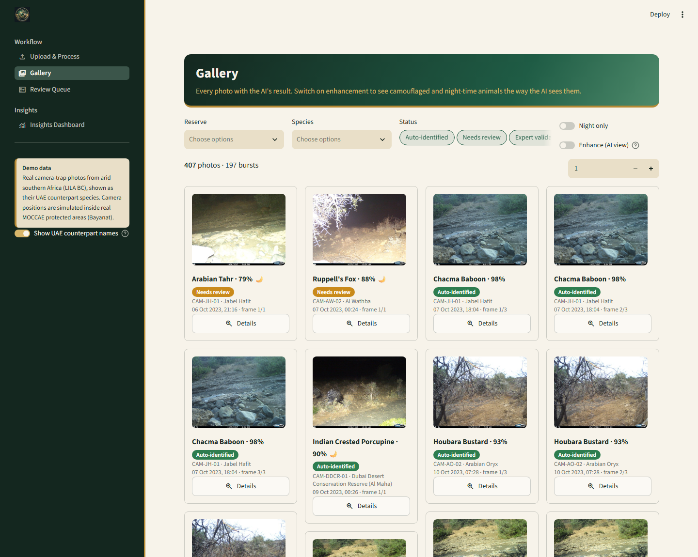
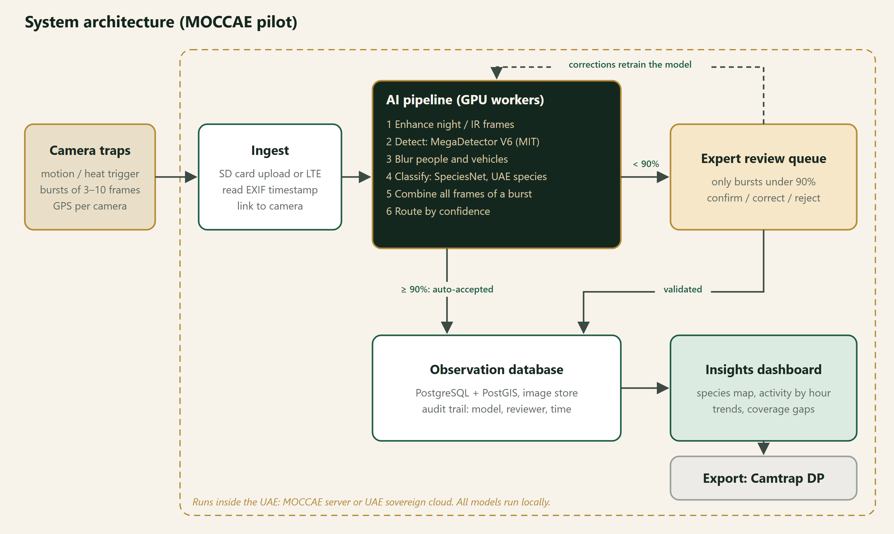
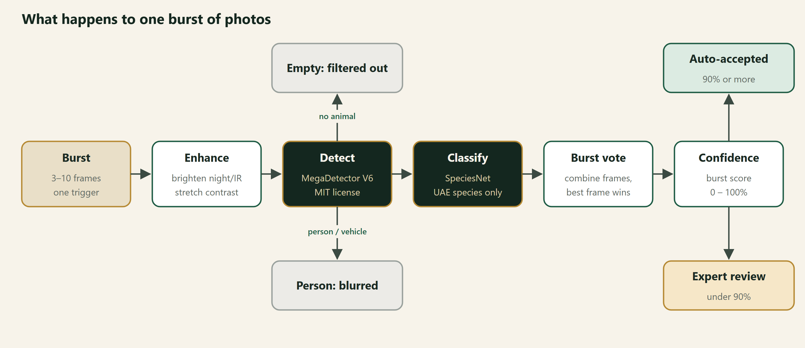
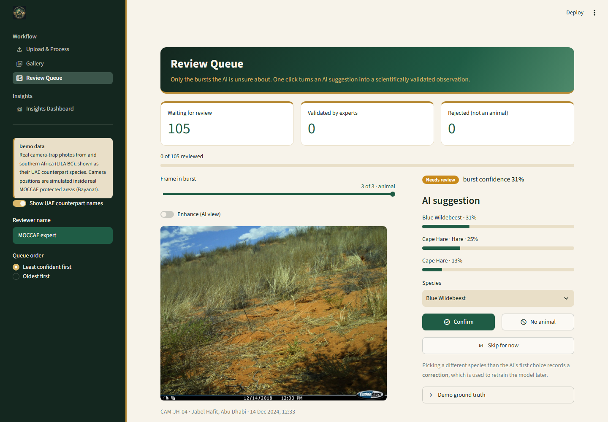

<p align="center"></p>

# KAMouflage Vision

Rangers in the UAE set camera traps that take thousands of photos. Most are empty, and many show an animal
half-hidden in the sand at night. Today someone checks every one by hand.

KAMouflage Vision filters the empty frames, identifies the species, and sends only the uncertain shots to an
expert. What comes out is a map of where each species is and when it's active.

Built for the MOCCAE camera-trap challenge at UAE Hackathon 2026 (Track 2, Abu Dhabi).



## Run it

```bash
python -m venv .venv
.venv\Scripts\activate          # macOS/Linux: source .venv/bin/activate
pip install -r requirements.txt
streamlit run code/app/app.py
```

Opens at http://localhost:8501. The demo data is already in the repo.

## How it works



Each burst of photos goes through the same steps:



All models are MIT or Apache-2.0 licensed and run locally, so no images leave the UAE.
We avoid MegaDetector v5 because it's AGPL.

## The app

| Screen | What it does |
|---|---|
| Upload & Process | Replays a camera's SD card through the pipeline, or takes your own photos |
| Gallery | Every photo with the AI's result; toggle enhancement to see night shots clearly |
| Review Queue | An expert confirms or corrects only the uncertain bursts |
| Insights Dashboard | Reserve map, coverage gaps, activity by hour, trends, CSV export |



## Data

- **Photos:** 600 real camera-trap images from arid southern Africa ([LILA BC](https://lila.science)). They stand
  in for UAE species: gemsbok for Arabian oryx, caracal for caracal, and so on.
- **UAE data:** protected areas and the local bird list from MOCCAE on [Bayanat](https://bayanat.ae), plus UAE
  species and IUCN status from [GBIF](https://www.gbif.org/country/AE/summary).
- **Simulated:** camera positions inside the real reserves.

Details in [data/README.md](data/README.md).

## Repo

```
code/app/            Streamlit app
code/data_pipeline/  downloads and cleans the data
code/diagrams/       draws the diagrams above
data/                photos and tables
docs/                diagrams and screenshots
```

The AI results in `data/results/predictions.csv` are demo values until `code/ai_pipeline/` is ready
(see [code/CONTRACT.md](code/CONTRACT.md)). To regenerate them: `python code/app/mock_predictions.py`.

New to the project? [PROJECT_NOTES.md](PROJECT_NOTES.md) has the full background and decisions.
Open questions and risks: [docs/CHECKLIST.md](docs/CHECKLIST.md).
